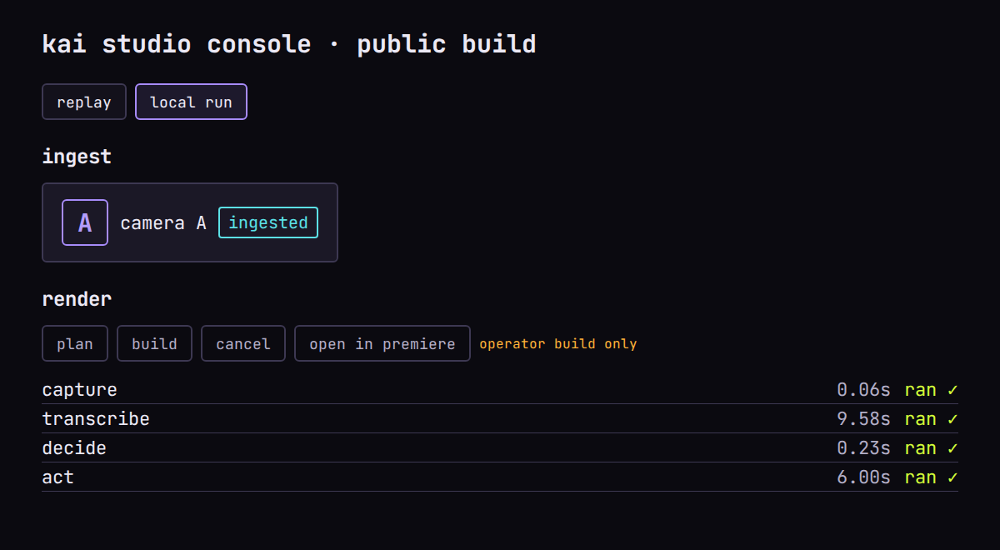

# kai studio console

> This repository has no license file. All rights reserved: judges and readers may view and run it, but no reuse rights are granted.

A laptop-local, offline `capture -> transcribe -> decide -> act` pipeline
(the `kai_slice` package, below) plus a read-only console build that shows
a run's own capture, decisions and timings. It takes a camera card,
transcribes it word-for-word, decides a cut (either a scripted multi-take
conversation or a cue/densest-window clip), and renders the cut plus an
FCP7 XMEML edit list — four stages, each timed and sha256-stamped into
`run-record.jsonl`.

This repo is exported from a private development repo by an
allowlist-and-scrub gate: its own commit history holds only its own export
snapshots, never the private repo's history. **[ACTIVITY.md](ACTIVITY.md)**
summarizes that private development history in three counts-only tables —
commits per week, merged PRs per week, and Python test functions per month —
generated from it by the private repo's own tooling.

Requires Python >= 3.11 with `ffmpeg` and `ffprobe` on `PATH` — `ffmpeg` is
required: `./demo` probes the card with `ffprobe` and renders the cut with
`ffmpeg`.

## Quickstart (five minutes)

```bash
python3 -m venv .venv && . .venv/bin/activate && pip install -e .
./scripts/fetch-model                # once: after the install, the only command that opens a network connection
./demo                               # the committed sample card through all four stages
python -m kai_slice serve demo-out   # serves the console at http://127.0.0.1:8920/
```

Open the address it prints and switch to "local run" to see this run's own
sha256 checks and per-stage timings — the same view below, generated from a
real run on the author's development machine (the AMD Ryzen 5 3600 named in
the walkthrough's sample timings; the same run as that block, so the times
match it) by `scripts/capture-console-screenshot`:



## What you are looking at

HackFW judges six signals; here is each one's evidence in this repo, no
claims beyond what runs:

| Signal | Evidence |
| --- | --- |
| Industrial Usefulness | `./demo` turns one camera card into a word-matched cut plus an FCP7 edit list — the same shape a professional editor's round-trip needs, re-homed from the private pipeline (`kai_slice/decide.py`, `kai_slice/act.py`) |
| Physical Robustness | `kai_slice/capture.py` verifies sha256 on both sides of the card copy and refuses by name on a mismatch; `kai_slice/console.py`'s `TooManyCamerasError` refuses a card with more media files than the 3-camera model supports, before any heavier stage runs |
| Edge-to-AI Pipeline | `kai_slice/transcribe.py` runs `faster-whisper` locally (CPU, `int8`); `scripts/fetch-model` is the only code path that opens an outbound connection, and only once, before the model is pinned on disk (`kai_slice/model_pins.py`) |
| Data Sovereignty | `tests/test_structural.py` proves `kai_slice` imports nothing from `ops` or `kai_studio` and touches no network module except the model fetch and `kai_slice serve`, which only **listens** on `127.0.0.1` (`kai_slice/serve.py`) |
| Measured Performance | every `./demo` run prints a wall-clock row per stage plus the total, written to `run-record.jsonl`; `<out>/console/build.json` carries each step's wall time and input/output sha256, and the console's render screen (the view above) renders each step's name and status against that same record |
| Enterprise Readiness | `pyproject.toml` bounds dependencies (major-version ranges) into a plain venv with no kai-studio package on the path; an allowlist-and-scrub gate in the private kai-studio repo (not shipped in this tree) produced this export, refusing to write anything that fails a secret, private-path or denylisted-name scan |

<details>
<summary>Full walkthrough — requirements, install, every command, and the technical detail behind each guarantee</summary>

## Requirements

- Python >= 3.11
- `ffmpeg` / `ffprobe` on `PATH`
- `espeak-ng` on `PATH` (only needed to generate the synthetic stand-in
  sample via `scripts/make-stand-in-sample`; not needed to run `./demo` or
  the CLI)

## Install

```bash
python3 -m venv .venv
source .venv/bin/activate
pip install -e .
# for tests/lint:
pip install -e ".[dev]"
```

Dependencies are plain PyPI packages (`faster-whisper`, `jsonschema`); this
installs with no package from the private development repo on the path.

## 1. Fetch the model (once)

```bash
./scripts/fetch-model
```

Downloads the `faster-whisper` `small` model (CPU, `int8`) into
`./models/small/` — about **464 MB**. This is the **only** command in this
tree that opens an outbound connection. Everything else, including
`./demo` and `python -m kai_slice run`, reads the model from that local
directory and never touches the network again.

**Pinned revision.** The default model's Hugging Face revision is pinned
to one constant, `DEFAULT_MODEL_REVISION` in `kai_slice/model.py`, and the
expected sha256 of every file in that revision ships in the tree
(`kai_slice/model_pins.py`). What `fetch_model` guarantees:

- `revision=` is passed only to a downloader whose signature names a
  `revision` parameter (faster-whisper's `download_model` does); a
  `**kwargs` or un-introspectable downloader is not trusted to honour it.
- When the revision has shipped hashes (the default does), the fetched
  files must match them exactly — on the first fetch too, so nothing is
  trusted on first use. On a mismatch the fetch refuses by name and deletes
  every file it fetched (the unexpected ones too), so nothing loadable is
  left.
- A model with no shipped hashes — a non-default model (`--model base`), or
  a revision not listed in `kai_slice/model_pins.py` — **refuses** unless you
  pass `--allow-unpinned`, which prints a warning: such a model is not
  verified and gets whatever upstream serves. Even then, a named revision
  must be proven by the downloader's own record (its snapshot path, or its
  download metadata), or the fetch refuses; a downloader that can't take
  `revision` at all refuses. The default model needs no flag.
- Before anything is downloaded, `--dest` must be absent, empty, or already
  this model's own directory (only the pinned file names plus the
  downloader's `.cache/`, or — for an unpinned fetch — the
  `.kai-unpinned-model` marker a previous fetch of the same model wrote).
  Anything else refuses by name and touches nothing: the fetch never
  downloads into a directory holding your files, and never asks you to
  delete them.

Bump the pin deliberately: look up the new commit, update the constant, and
add its hashes to `kai_slice/model_pins.py` in the same change.

## 2. Run the demo

```bash
./demo
```

Runs `kai_slice` on the sample card in `samples/card-01/` (see
`samples/README.md` for its provenance) and prints Measured Performance — a
wall-clock row per stage plus the total — then the path to the rendered
`demo-out/cut.mp4`. A real run on the 33 s sample, from a fresh clone with
the network cut off (`unshare -rn ./demo`), CPU-only (`./demo` never uses a
GPU), on an AMD Ryzen 5 3600 (6-core):

```
Measured Performance
  stage          seconds
  capture          0.060
  transcribe       9.579
  decide           0.226
  act              6.001
  total           15.865
cut: .../demo-out/cut.mp4
```

`./demo` refuses (non-zero exit, no network fallback) if `./scripts/fetch-model`
has not been run yet.

**Safe `--out`.** Every output directory `./demo` creates carries a marker
file, `.kai-demo-out`, whose content identifies `./demo`. A later run into
the *same* `--out` replaces it only when that marker is a regular file (not
a symlink or a directory) holding exactly that content **and** every
top-level entry is one `./demo` itself writes: `.kai-demo-out`, `console/`,
`cut.mp4`, `decision.json`, `edit.xml`, `ingest/`, `run-record.jsonl`,
`transcripts/`. The old tree is first renamed aside
(`<out>.kai-demo-old-<pid>`), re-checked, and only then deleted; a refusal
on the re-check moves it back untouched. Anything else refuses by name with
a non-zero exit, deleting nothing:

- a marked directory that also holds any other entry (a file you saved
  there) — the foreign entries are listed;
- a non-empty directory without the marker, or with a marker of any other
  content (a copied tree, a hand-made marker), or a marker that is a
  directory or cannot be read;
- a symlinked `--out` or a symlinked marker;
- `/`, `$HOME`, the current directory, this tree, or any directory
  containing `$HOME` or this tree;
- a plain file at `--out`.

The previous output is also kept when the run refuses for a missing model.
An existing *empty* directory with no marker is used and marked; a later
re-run still refuses if you have since saved anything else into it.

**Scrubbed refusals.** A refused run's reason is written to
`<out>/console/build.json` with this machine's absolute paths replaced (`<out>`,
`<card>`, `<models>`, `<root>` for this tree, `~` for `$HOME`) — only whole
absolute paths at a path boundary (followed by `/`, a quote, whitespace,
`:`, `,`, `)`, `;`, `]` or the end), never a bare relative string, so the
reason text itself is never altered.

## 3. Build your own sample card

```bash
# No real footage yet? Generate a free, local, no-download stand-in
# (espeak-ng speech over an ffmpeg lavfi picture):
./scripts/make-stand-in-sample --out /tmp/stand-in.mp4

# Either the stand-in or a real delivered clip, transcoded into the
# shipped card (720p H.264/AAC, 25 MB or less, sha256 manifest,
# samples/README.md provenance line):
./scripts/make-sample /tmp/stand-in.mp4 --provenance "Synthetic stand-in: no real footage."
```

## Network policy

- `scripts/fetch-model` is the only code path that opens an outbound
  connection (verified by `tests/test_structural.py` for the `kai_slice`
  package and `tests/test_scripts_structural.py` for the `scripts/` and
  `./demo` entry points). `scripts/make-stand-in-sample` uses `espeak-ng`'s
  built-in voices — no download.
- `kai_slice serve [<out_dir>]` only ever **listens** on loopback; it never
  dials out and is never reachable off the machine.

## Run the CLI directly

```bash
python -m kai_slice run <card_dir> --out <out_dir> --model ./models/small
python -m kai_slice script-check <card_dir> --script <script.txt> --model ./models/small
```

## 4. See the run in the console

The console has two offline modes; neither ever reaches a server other than
your own machine. Both are served by `kai_slice serve`, which hosts the
console build in `console/` on `127.0.0.1` — opening `console/index.html`
straight from disk (`file://`) shows a blank page, because browsers refuse
its module script and stylesheet from a `file://` page.

**Replay** — serve the console with no run directory and open the printed
address:

```bash
python -m kai_slice serve
# Serving the console at http://127.0.0.1:8920/ (replay only; read-only, GET only)
```

It shows a bundled recorded sample run (fonts and the GSAP library are
bundled too, so this works with the network off).

**Local run — the judge's own run.** After `./demo` (or any `kai_slice run`)
writes `<out>/console/{ingest,build}.json`, serve that one directory:

```bash
python -m kai_slice serve demo-out
# Serving the console at http://127.0.0.1:8920/ (run data from demo-out/console/; read-only, GET only)
```

Open the address it prints (`--port` is free to choose; `--host` is not —
only a loopback name is ever accepted, see below) and switch to "local
run" — the ingest and render screens show this run's own sha256 checks and
per-stage timings, with every write control (plan, build, cancel, open in
Premiere) disabled and labelled "operator build only": this build carries no code for `POST /jobs`,
`/approve`, `/reject` or `/routing` at all — those stay in the private
operator build.

What `serve` will and will not do:

- binds `127.0.0.1` only (also `localhost`, or `::1` on a real IPv6
  socket) and refuses any other `--host` before opening a socket;
- answers only a request whose `Host` header is `127.0.0.1`, `localhost`
  or `[::1]` with the bound port (421 otherwise), so a DNS-rebinding page
  that reaches the port under its own name reads nothing;
- answers GET only: a `*.json` path (judged after URL-decoding) only from
  the JSON files under `<out>/console/`, anything else only from the
  shipped `console/` build;
- 404s a path that tries `..`, an absolute path, a NUL byte, or a symlink
  that would resolve outside the directory it is routed to;
- sends `X-Content-Type-Options: nosniff` and a `Content-Type` that matches
  each file's extension, and no CORS header — the console is served from
  this same origin, so no other web page can read your run off the port;
- gives each connection its own thread and a 10 s socket timeout, so a
  client that connects and goes silent never blocks anyone else.

## Regenerating the screenshot

`scripts/capture-console-screenshot` reruns the quickstart — `./demo` if
`demo-out/` has no run yet, then `kai_slice serve`, then a headless
Chromium (Playwright) capture at a fixed 1200x660 viewport — and overwrites
`docs/console.png`. `page.screenshot()` captures page content only, so no
hostname or URL ever enters the image; the ingest panel's one-time "clock
started" line is removed from the DOM before the shot (`Element.remove()`,
not a style change, so it needs no extra Content-Security-Policy
allowance beyond what `kai_slice/serve.py` already sends) so the image
never goes stale. Needs `pip install -e ".[screenshot]" && playwright
install chromium` — not a runtime dependency of `kai_slice` itself, so it
is not part of `pip install -e ".[dev]"`.

## Tests

```bash
pip install -e ".[dev]"
pytest tests/
```

</details>
